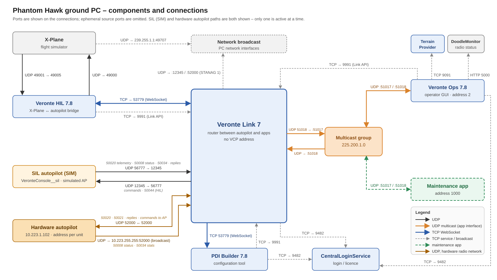

# Veronte Link – Ground Station Architecture and Application Interface

| | |
|---|---|
| **Scope** | Components of the Phantom Hawk ground PC, their ports and connections, and the interface through which an application exchanges VCP messages with the autopilot via Veronte Link. |
| **Applies to** | Veronte Link 7, Veronte Ops 7.8, Veronte HIL 7.8, Veronte 1x PDI Builder 7.8, SIL 7.8.43, X-Plane |
| **Status** | SIM configuration verified (loopback capture and port table), with and without Veronte Ops running. Hardware AP: receive path and AP address discovery through the application interface verified. |
| **Related** | `vcp-protocol.md` · `telemetry-feedback.md` · `trigger-buttonevent.md` |

---

## 1. Overview



Veronte Link is the single router between the autopilot (AP) and all PC applications:

- It holds the link to the AP (SIL in SIM mode, the hardware AP otherwise).
- It republishes **every** packet received from the AP to all connected applications.
- It forwards packets sent by applications to the AP.
- It routes by VCP address and has no address of its own on the data path.

Applications connect to Link through one of two equivalent transports that carry the same **application framing** (chapter 4):

| Transport | Direction | Endpoint | Used by |
|---|---|---|---|
| UDP multicast | Link → apps | group `225.200.1.0`, port **51017** | Veronte Ops |
| UDP multicast | apps → Link | group `225.200.1.0`, port **51018** | Veronte Ops |
| WebSocket (TCP) | both | Link server, TCP **53779** | Veronte HIL, PDI Builder, Link's own AP bridge |

## 2. Components

### 2.1 Veronte components

| Component | Role | VCP address | Endpoints |
|---|---|---|---|
| **Veronte Link 7** | router / hub | – | UDP `12345` AP side (SIM) · UDP `52000` AP side (hardware) / STANAG · UDP `51018` application multicast · TCP `53779` WebSocket hub · TCP `9991`, `9535` Link API · STANAG type 1 broadcast sender (ephemeral source ports) · client of CentralLoginService |
| **SIL autopilot** (`VeronteConsole__sil` 7.8.43) | simulated AP | dynamic (observed 6041) | UDP `127.0.0.1:56777` (receive); sends to Link UDP `12345` |
| **Hardware autopilot** (firmware 7.8.80) | real AP | dynamic (observed 6248) | `10.223.1.102`, UDP `52000` (Ethernet, radio network `10.223.0.0/16`) |
| **Veronte Ops 7.8** | operator GUI (CUCS) | 2 | UDP `0.0.0.0:51017` (multicast member), sends to group `:51018` · TCP client of Link `9991`, CentralLogin `9482`, Terrain Provider `9091`, DoodleMonitor `5000` |
| **Veronte HIL 7.8** (+ backend `hil.exe`) | bridges X-Plane ↔ AP; produces simulated navigation (50044) | – | WebSocket client of Link `53779` · TCP client of Link `9991` · UDP `49005` (from X-Plane) · UDP to X-Plane `49000` (ephemeral source port) · TCP `7236` (own UI) |
| **Veronte 1x PDI Builder 7.8** | configuration tool | – | WebSocket client of Link `53779` (receive) · TCP client of Link `9991`, CentralLogin `9482` |
| **CentralLoginService** | Embention login / licence service | – | TCP `9482` |
| **Veronte Terrain Provider 7** | terrain data for Ops | – | TCP `9091`, UDP `50734` |
| **VeronteToolbox** | Embention launcher / updater | – | TCP `8083` and internal loopback pairs |

### 2.2 Other ground-PC components

| Component | Role | Endpoints |
|---|---|---|
| **X-Plane** | flight simulator used by HIL | UDP `49000` (from HIL), `49001` (to HIL `49005`), `49010` · TCP `1338` · discovery beacon to `239.255.1.1:49707` |
| **DoodleMonitor** | Doodle Labs radio monitor | TCP `5000`, HTTP API (`/api/data`, `/api/status`) |
| **mediamtx** | payload video server | RTSP `8554`, HLS `8888`, UDP `8000`, `8001`, `8890`, `8892`, `8893` |
| **PhantomClock** | Phantom Labs utility | TCP `5005` |

## 3. Link interfaces

### 3.1 Autopilot side

| Mode | Link endpoint | AP endpoint | Content |
|---|---|---|---|
| SIM (SIL) | UDP `12345` | SIL UDP `127.0.0.1:56777` | full VCP packets (`vcp-protocol.md` chapter 4) |
| Hardware | UDP `52000` on the PC's Ethernet interface (`10.223.10.150`) | `10.223.1.102:52000` | full VCP packets; see 3.1.1 |

#### 3.1.1 Hardware AP traffic on the Ethernet interface

| Source | Destination | Content |
|---|---|---|
| `10.223.1.102:52000` (AP) | `10.223.10.150:52000` (Link) | telemetry 50020 / 50021, STANAG 2 / 3, replies – complete VCP packets, one per datagram |
| `10.223.1.102:52000` (AP) | `10.223.255.255:52000` (broadcast) | communication statistics 50034, status 50008 |
| `10.223.235.161:52000` (radio-side relay) | `10.223.10.150:52000` (Link) | the same AP packets as a byte stream: packets are split across datagrams and must be reassembled by sync byte and length |

Link merges both inputs and republishes each AP packet once on the application interface. Discovery replies were received twice on the hardware network; applications de-duplicate replies. This traffic is visible only on the Ethernet interface, not on the loopback adapter.

Observed load on the Ethernet interface (hardware AP, 7.9 s capture, AP in phase INITIAL):

| Traffic | Rate | VCP packets | On the wire (incl. Ethernet / IP / UDP headers) |
|---|---|---|---|
| Telemetry 50020 V0 / V1 / V2 + 50021 | 9.8 + 3.3 + 0.5 + 9.8 msg/s | 27.8 kbit/s | 35.7 kbit/s |
| Communication statistics 50034 (broadcast) | 182 msg/s | 58.2 kbit/s | 119.4 kbit/s |
| System status 50008 (broadcast) | 47 msg/s | 31.6 kbit/s | 47.3 kbit/s |
| Radio-side relay copy | 84 datagrams/s | 28.8 kbit/s | 58.4 kbit/s |
| Total | | ~148 kbit/s | ~262 kbit/s |

These endpoints are private to Link and the AP. Ports `12345` and `56777` exist only with the SIL; with the hardware AP the link runs on port `52000`. Applications shall not bind or send to any of them – the application interface (sections 3.2, 3.3) is the same in both modes.

### 3.2 Application multicast interface

| Item | Value |
|---|---|
| Group | `225.200.1.0` |
| Link → apps | destination port **51017** (Link sends from 51018) |
| Apps → Link | destination port **51018** |
| Interface | `127.0.0.1` (applications on the same PC) |
| Framing | application framing (chapter 4), one packet per datagram |
| Content Link → apps | a copy of every packet received from the AP |
| Content apps → Link | packets to be forwarded to the AP |

Several applications can be members at the same time (Ops binds `0.0.0.0:51017` with address reuse). Link publishes to the group whether or not any member (including Ops) is present.

### 3.3 WebSocket hub

| Item | Value |
|---|---|
| Server | Link, TCP `53779` |
| Messages | one binary WebSocket frame per packet, application framing |
| Clients | HIL (sends 50044, receives all AP packets), PDI Builder (receives), Link's AP bridge (TCP `53780`) |

### 3.4 Link API (TCP 9991, 9535)

Clients: Ops, HIL, PDI Builder and browser sessions. Only keep-alive traffic has been observed. Not required for data exchange.

### 3.5 Broadcast

Link re-broadcasts the CUCS authorization request (STANAG type 1, every 5 s) from ephemeral UDP source ports to the PC's network broadcast addresses on ports `12345` and `52000`, and to UDP peers it has registered on port `52000`.

## 4. Application framing

Packets exchanged between Link and applications are VCP packets without the first 6 header bytes (Sync, Flags, Ident, Session, CRC8) and without the final CRC32:

| Offset | Size | Field | Byte order |
|---|---|---|---|
| 0 | 2 | Reserved (0) | big |
| 2 | 2 | Len | big |
| 4 | 4 | Src | big |
| 8 | 4 | Dst | big |
| 12 | 2 | Type | big |
| 14 | 2 | Properties | big |
| 16 | Len | Payload | per message (little endian for private messages) |
| 16 + Len | 0 or 4 | Optional checksum – CRC-32 over bytes 0 … 15 + Len, present when checksum type = 3 | big |

- Link → apps: datagram = original AP packet `[6 : −4]`.
- Apps → Link: Link adds Sync, TTL, Ident, Session, CRC8 and CRC32 before sending to the AP.
- Checksum rules: `vcp-protocol.md` chapter 5.

## 5. Data flows

| Flow | Transport | Typical rate | Content |
|---|---|---|---|
| AP → Link | UDP (SIM: 56777 → 12345; hardware: 52000 → 52000, plus broadcast to `10.223.255.255:52000`) | 45–70 /s | telemetry 50020 / 50022, communication statistics 50034, status 50008, STANAG 2 / 3, replies |
| Link → AP | UDP (SIM: 12345 → 56777; hardware: 52000 → 52000) | ~63 /s with HIL | commands from apps, 50044 simulated navigation |
| Link → apps | multicast → `225.200.1.0:51017`; WebSocket 53779 | same as AP → Link | copy of every AP packet |
| Apps → Link | multicast → `225.200.1.0:51018`; WebSocket 53779 | on demand | commands; Ops' STANAG type 1 every 5 s |
| HIL → Link | WebSocket 53779 | ~63 /s | 50044 simulated navigation |
| X-Plane → HIL | UDP 49001 → 49005 | ~62 /s | X-Plane DATA (aircraft state) |
| HIL → X-Plane | UDP → 49000 | ~33 /s | X-Plane DATA (HIL outputs) |
| Link → network | UDP broadcast, ports 12345 / 52000 | every 5 s | STANAG type 1 |
| Ops → services | TCP 9091, 9482, 5000 | low | terrain, login, radio status |
| Apps → Link API | TCP 9991 / 9535 | keep-alive | – |

## 6. Integrating an application

### 6.1 Receiving

1. Create a UDP socket, enable `SO_REUSEADDR`, bind `0.0.0.0:51017`.
2. Join group `225.200.1.0` on interface `127.0.0.1` (`IP_ADD_MEMBERSHIP`).
3. Parse each datagram as application framing (chapter 4); verify the optional checksum when present.
4. Dispatch by Type; keep only replies whose Dst equals the application's own address, plus broadcast and telemetry as needed.
5. Determine the AP address from the Src of the System status (50008) broadcast, or with a Discovery request to `0xFFFFFFFF` (`vcp-protocol.md` section 3.2). Accept telemetry only from that Src.

### 6.2 Sending

1. Build the application frame with the application's own Src address, Dst = the AP address determined in 6.1 and Properties `0xA0C0`.
2. Append the optional checksum (CRC-32 over bytes 0 … 15 + Len).
3. Send to `225.200.1.0:51018` with `IP_MULTICAST_IF = 127.0.0.1`, multicast TTL 1, multicast loopback enabled.
4. Await the reply on the receiving socket (match by Type, Dst and message-specific identifiers).

### 6.3 Rules

- Use a dedicated VCP address (not 2).
- Use only the application interface (`225.200.1.0:51017` / `:51018`); never bind or send to the AP-side endpoints (`12345`, `56777` in SIM; `52000` with hardware).
- Do not depend on Veronte Ops being present.
- Send only on explicit operator action (no automatic commands on start-up or reconnect).

## 7. Side effects and troubleshooting

| Symptom (e.g. in Wireshark) | Explanation |
|---|---|
| ICMP *port unreachable* for UDP to `127.0.0.1:49000` | HIL sends X-Plane DATA while X-Plane is not running. Harmless. |
| ICMP *port unreachable* for UDP from Link `52000` to closed local ports | Link keeps sending STANAG type 1 to UDP peers it registered earlier (e.g. tools that sent directly to port 52000). Cleared by restarting Link. |
| Application receives nothing on 51017 | Group not joined on `127.0.0.1`, or socket bound without address reuse. |
| Commands accepted but no reply received | Reply is addressed to the Src used in the request; filter on the correct Dst. |
| Wireshark shows Link traffic as "VCP" and hides raw bytes | A Lua dissector (`veronte_vcp`) is installed; disable it to see raw payloads. |

## 8. Verification status

| Item | Status |
|---|---|
| Component and port inventory (SIM) | verified |
| Multicast framing = AP packet `[6 : −4]`, identical to WebSocket payloads | verified |
| Receiving telemetry from the group while Ops is running | verified |
| Sending Discovery and User Event via the group with an own address (1000) | verified – replies addressed to 1000 |
| Receiving telemetry and sending Discovery via the group with Ops closed | verified |
| Application independent of the AP-side ports 12345 / 56777 (uses only 51017 / 51018) | verified |
| Hardware AP: telemetry received by Link on UDP 52000 and republished on the multicast group (Src 6248) | verified |
| Hardware AP: address from System status (50008) Src and from Discovery to `0xFFFFFFFF` via the group (6248, firmware 7.8.80) | verified |

## 9. Examples

### 9.1 Telemetry datagram received on 225.200.1.0:51017 (start, SIL)

```
00 00 | 00 82 | 00 00 17 99 | 00 00 00 02 | C3 64 | 20 00 | C0 8C 97 47 CA 56 04 93 …
Res.  | Len   | Src 6041    | Dst 2       | 50020 | props | payload: timestamp, hash 0x930456CA (vector V0) …
```

### 9.2 Discovery request sent to 225.200.1.0:51018 (own address 1000, SIL address 6041)

```
00 00 00 0E 00 00 03 E8 00 00 17 99 C3 51 A0 C0      Reserved, Len 14, Src 1000, Dst 6041, Type 50001, Props
00 00 00 00 00 00 00 00 00 00 00 00 00 00            payload (argument 0, version 0.0, time 0)
80 3E 6A 09                                          optional checksum
```
Reply received on the group: Type 50001, Src 6041, Dst 1000.

### 9.3 User Event 78 sent to 225.200.1.0:51018 (own address 1000, SIL address 6041)

```
00 00 00 08 00 00 03 E8 00 00 17 99 C3 52 A0 C0      Reserved, Len 8, Src 1000, Dst 6041, Type 50002, Props
00 00 4E 00 65 A2 E0 DD                              argument 0, event 78, RX ID 0xDDE0A265
80 76 0D FF                                          optional checksum
```
Reply payload on the group (Dst 1000): `01 00 4E 00 65 A2 E0 DD 01 00 01 00 01 00` – ACK 1, event 78, RX ID echo, enabled 1, user 1, licence 1.

### 9.4 AP address discovery on the hardware radio network

Discovery request to Dst `0xFFFFFFFF` from own address 1000: see `vcp-protocol.md` section 10.4.
Received on the group: System status 50008 from Src 6248 (application ID 3, phase 20); two identical Discovery replies from Src 6248 to Dst 1000.
